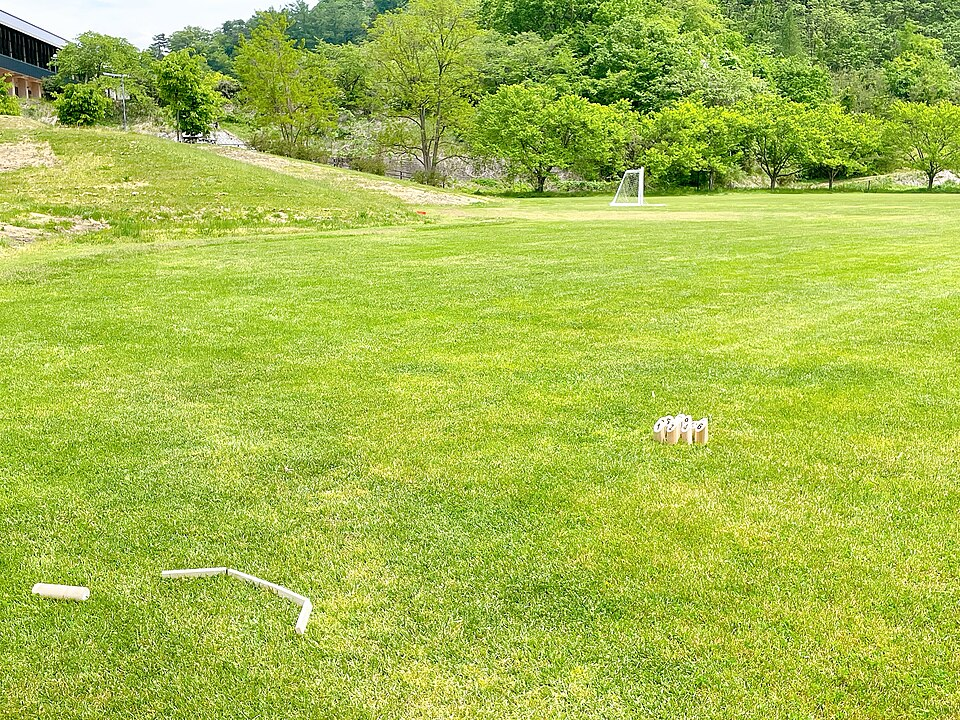
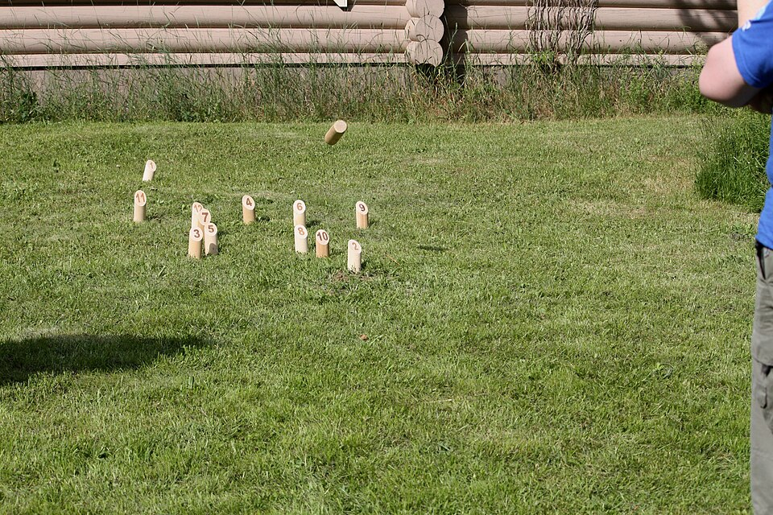
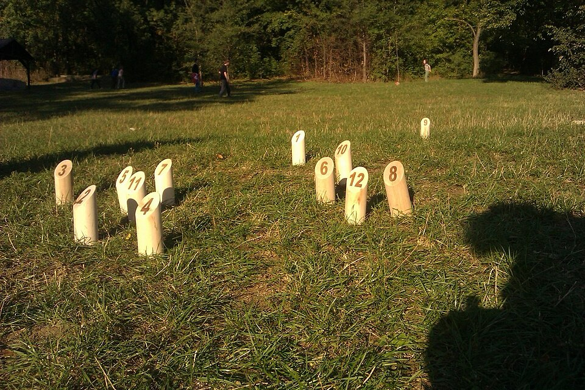
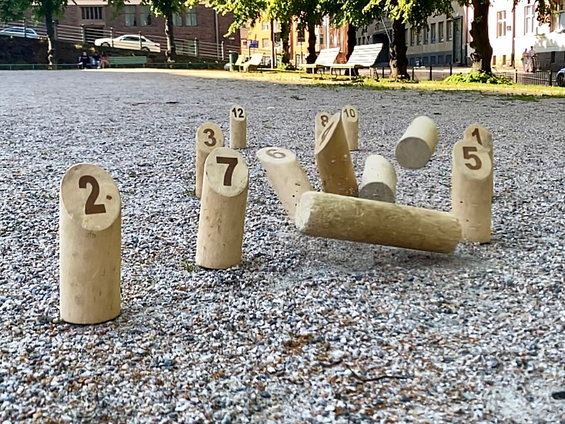

# 目標の見た目（フェーズ0で決定・フェーズ4で作り込む）

方向性: **フォトリアル寄り**。晴れた日の芝生の公園で、本物のモルックを遊んでいる写真に見えること。

## 目指す画（言葉での定義）

| 要素 | 目標 |
| --- | --- |
| 時間帯・光 | 晴れた午後（太陽高度 40〜50°）。やわらかい影、空からの青い環境光 |
| 芝生 | 短く刈った公園の芝。近くは草の質感、遠くは自然にぼける。色はやや黄緑寄りで彩度を上げすぎない |
| 棒・ピン | 明るい白木（白樺・松系）。木目、角の丸み、使い込んだ小さな傷と汚れ。焼き印風の濃い茶色の数字 |
| 背景 | 遠景に木立と空。作り込みすぎず、ぼかして奥行きを出す |
| カメラ | 投げる人の目線の高さ（約1.5m）から。被写界深度は弱め（ピンははっきり見える） |
| 後処理 | トーンマッピング（ACES/Neutral）、軽いブルーム、ビネット控えめ |

## 参考にする資料

- 実物写真: [Wikimedia Commons: Category:Mölkky](https://commons.wikimedia.org/wiki/Category:M%C3%B6lkky) — 芝生でのプレイ写真・ピンの並び
- 実物写真: [Wikipedia: Mölkky](https://en.wikipedia.org/wiki/M%C3%B6lkky) の掲載写真（芝生でのカジュアルなプレイ、初期配置）
- 素材候補（フェーズ4）: [Poly Haven](https://polyhaven.com/) の晴天公園系 HDRI・芝生・木材テクスチャ（CC0）

## 選んだ参考画像

画像は `Docs/reference/`（クレジットは `Docs/reference/CREDITS.md`）。

| 画像 | 参考にする点 |
| --- | --- |
|  `01_overall_park.jpg` | **全体の雰囲気の基準。** 晴れた昼の明るい芝生の公園、遠くの木立と空。投げるラインから見た3.5m先のピンの小ささ（＝距離感）もこれに合わせる |
|  `02_throw_view.jpg` | **カメラ。** 投げる人の肩越しに、芝の上を飛ぶ棒とピンの並びが見える構図。芝の色むらと質感 |
|  `03_wood_light.jpg` | **木と光。** 夕方寄りの暖かい光で白木が明るく浮く感じ、長い影、焼き印風の茶色の数字、斜めカットの形 |
|  `04_wood_closeup_impact.jpg` | **木の質感と当たった瞬間。** 近くで見たときの木目・繊維感・端の欠け。ピンが弾け飛ぶ瞬間はスローモーションの見せ方の参考（地面は砂利なので芝に置き換える） |

**決めたこと**

- 基本の光は 01 の「晴れた昼」。03 の暖かさを少し足して、木が白く飛びすぎないようにする
- 数字は黒ではなく **焼き印風の濃い茶色**（03・04）
- 木の色は明るい白木〜薄いベージュ。新品すぎず、細かい傷と汚れを入れる

## WebGL での注意

- スマホ（画質「低」）では影の解像度・ポストエフェクトを落としても、**色味と光の方向は同じ**に見えることを優先する
- 芝はテクスチャ＋法線マップが基本。草のジオメトリ（毛並み）は画質「高」のみ
